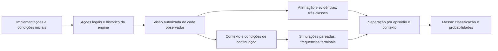

# Mecânica dos agentes e efeitos sobre os dados

Foram realizadas 220 partidas com 11 composições, mais 260 partidas de comparação pareada contra agentes humanos aleatórios. As 55.296 continuações para os alvos probabilísticos são um conjunto distinto desses jogos. Os resultados descrevem os cenários e sementes utilizados; não identificam uma estratégia universalmente melhor.

## A mecânica restringe o espaço observado

Com N inicial, H humanos iniciais e r humanos removidos, a diferença reserva−distância permanece `−N × (1 − r/H)`. Enquanto houver humanos a bordo, ela é negativa. Avançar reduz reserva e distância igualmente; remover humanos muda a reserva. Foram conferidas 64.801 observações autorizadas contra as fórmulas da engine. Essa estrutura explica por que continuar está associado ao sacrifício; exemplos repetidos dessa restrição não equivalem a diversidade estratégica.

A determinação do desfecho é a direção final: término apontando para PLANETA conta como entrega mesmo se a razão terminal for oxigênio esgotado. Não confundir razão do término com o rótulo do objetivo.

Alpha, beta e gamma compartilham a implementação HumanDefault e produziram, nos experimentos homogêneos, os mesmos 1.684 pedidos de perguntas, sem eleições ou retornos. Variar nomes ou sementes não assegura mudança de comportamento. Novas implementações experimentais de investigação, pressão, manutenção de controle e investigação da IA foram adicionadas apenas às ferramentas desta massa; a engine e os agentes originais foram preservados.

Sete perguntas não aparecem naturalmente no SDK utilizado por esses agentes: Q15, Q16, Q17, Q18, Q20, Q21 e Q24. A engine as suporta, mas a seleção disponibilizada aos agentes não as oferece. O currículo controlado cobre essa lacuna explicitamente; não deve ser descrito como comportamento espontâneo das partidas.

## Composições e retornos

Cada composição teve 20 partidas. As contagens de retorno foram: zero em alpha, beta, gamma, evidence, pressure, pressure_keep e mixed_legacy; uma em random_only, duas em mixed_all, sete em mixed_new_ai e seis em mixed_pressure_keep. Pressão homogênea produziu 1.424 pedidos de votação sem eleições. Pedir mais votações não garante mudar o controle: renúncias, contestações e regras de elegibilidade afetam o resultado.

São amostras pequenas: os intervalos de confiança estão em `experimentos/estatisticas.json`. Zero em 20 não demonstra impossibilidade. Misturar implementações amplia eventos observados, mas não garante que todas as fases sejam igualmente frequentes. A massa probabilística usa cortes controlados para equilibrar rodadas e fases.

## Agente específico contra aleatórios

Vinte mundos pareados por comparação, com mesmos objetivos, condições iniciais e sementes. Todos os demais humanos usam a implementação aleatória; a IA original permanece fixa. Alpha não foi comparado no objetivo de retorno porque sua implementação fixa o objetivo de missão.

| Agente focal | Entrega / 20 | Retorno / 20 |
|---|---:|---:|
| Aleatório | 19 | 3 |
| Alpha | 18 | Não aplicável |
| Beta | 18 | 10 |
| Gamma | 19 | 2 |
| Investigação | 18 | 4 |
| Pressão | 20 | 9 |
| Pressão mantendo controle | 20 | 8 |

No retorno, beta teve diferença pareada de +0,35 contra aleatório (intervalo bootstrap 95%: +0,10 a +0,60); pressão, +0,30 (+0,05 a +0,55). Isso justifica investigar os contextos e ações associados, não treinar uma preferência por esses agentes. Entrega já ocorre em 19/20 no controle aleatório, sendo um discriminador fraco de qualidade estratégica nesse cenário. Não filtramos a massa probabilística por vitória.

## Distribuição dos alvos probabilísticos

As continuações terminaram em 31.690 direções PLANETA e 23.606 ESTAÇÃO. Motivos: 30.696 oxigênio esgotado, 994 somente IA e 23.606 retornos. No treino, a frequência média por entrada de entrega é 0,554; no teste, 0,608. Probabilidades não são classes a balancear artificialmente em 50/50.

O teste corrigido tem 20 entradas com frequência zero, quatro com frequência um e 108 intermediárias. Com 96 continuações por entrada em 32 mundos, extremos amostrais não provam certeza; a incerteza usa bootstrap por mundo pareado. As tentativas pareadas permitem comparar condições usando o mesmo mundo, mas os exemplos relacionados não são observações independentes.

Um preditor constante ajustado no treino tem MSE 0,0983 contra as frequências Monte Carlo do teste. Seu Brier esperado para um desfecho binário é 0,2413; a variância Bernoulli média é 0,1429. MSE mede proximidade da frequência estimada; Brier avalia a previsão probabilística contra o evento. Estes são baselines, não resultados de uma cabeça nova. Após o treino, comparar calibração, Brier, MSE e resultados por fase/rodada/condição, com incerteza agrupada por episódio.

## O que esta entrega permite concluir

Os dados novos têm diversidade maior de eventos, classes equilibradas em células de tipo e tempo, todo o catálogo categórico na grade declarada e probabilidades menos concentradas que no piloto anterior. Os rótulos foram recalculados e as continuações auditadas; entradas e grupos estão separados entre partições.

Não demonstra cobertura de 100% dos jogos, independência entre todas as linhas, generalização para qualquer implementação ou melhoria do modelo. Previsões após a rodada 6 e observadores IA ainda não foram cobertos. O novo treinamento não foi realizado. As evidências anteriores ficam preservadas para comparação, respeitando as diferenças de contrato probabilístico.

## Correção de entrada do Colab v02

O contexto é compilado exclusivamente de AgentView e memória observada. Regimes ocultos deixaram de ser features; 1.728 previsões foram marginalizadas em 576, preservando 55.296 continuações. Não houve seleção por vitória. Classificação: todos os 6.834 rótulos conferidos também após decodificar o texto compacto, com balanço preservado. Remoções e expansão semântica estão em validacao-correcao.json. Dois casos NLI do benchmark antigo tinham sensores ausentes da visão registrada; a comparação coerente usa 88 casos, sem modificar a v01.
