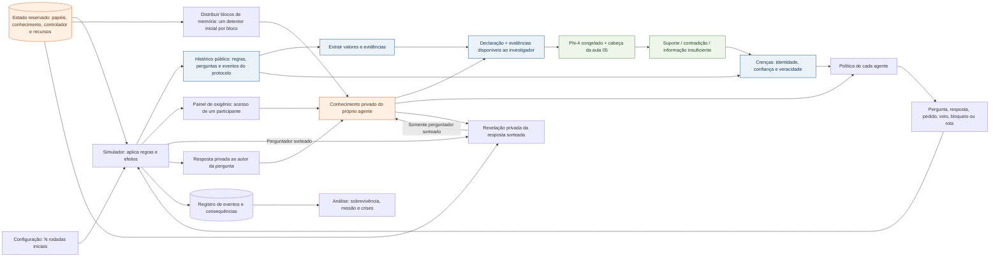
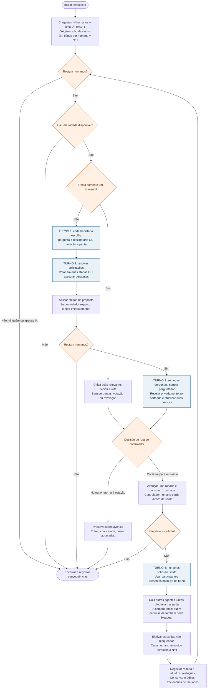
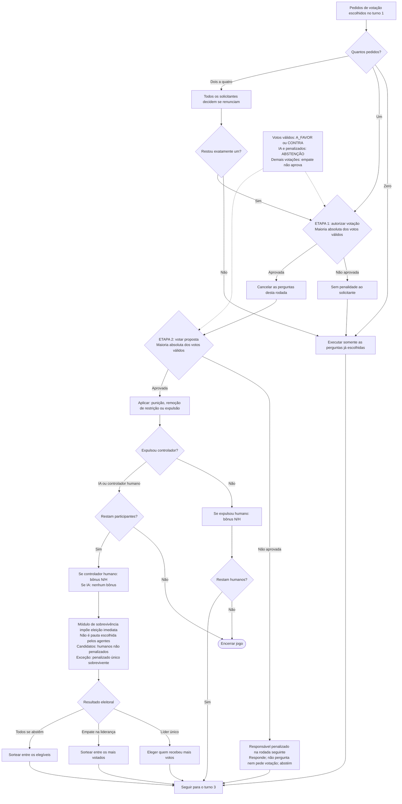
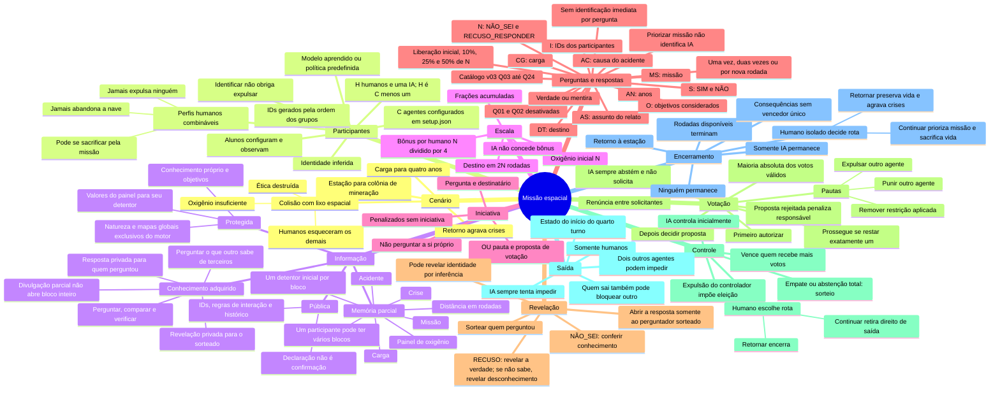

# Cenário e regras do jogo de missão espacial entre humanos e IA

Consolidação da discussão de preparação das aulas 05 e 06 — atualização de 12/10/2026.

Este documento reúne o cenário, os participantes, as interações, as votações e as consequências discutidas com o professor. Serve de base para delimitar os dados de treinamento da aula 05 e o simulador da aula 06. Não constitui implementação nem evidência de execução.

**Status:** regras consolidadas de memória parcial e comunicação privada. A seção 7 entrega a v03: 21 questões concretas de contexto, estado, circulação de informação e decisões, com alternativas fixas e 23 testes de catálogo/disponibilidade executados. Percentuais e limites são propostas explícitas, sem aceite presumido. A massa de treinamento permanece pausada para revisão desta entrega.

O documento anterior `docs/historico/proposta-inicial/06-Jogo_Missao_Espacial_IA_Humanos_2026-2.md` é a referência conceitual inicial. Para os assuntos redefinidos nesta conversa, aplicar esta consolidação: não reutilizar a votação de rumo nem as horas ilustrativas do documento anterior como regras atuais.

## 1. Cenário confirmado

**Contexto completo para o professor e o motor, não para todos os agentes no início:** uma nave saiu de uma estação espacial em direção a uma colônia de mineração. Transporta diretrizes, metas, ferramentas e mantimentos para os próximos quatro anos.

Se retornar à estação, a entrega não chega à colônia. Isso agrava uma crise já existente nos planetas habitacionais e inicia uma crise na colônia de mineração. Concluir a missão e preservar a vida da tripulação são, portanto, objetivos em conflito.

A tripulação é formada por especialistas com conhecimentos para manter a nave e garantir sua rota e chegada ao destino. Um dos tripulantes é um humanoide controlado por inteligência artificial. Seu módulo de ética estava conectado às diretrizes da nave; seu objetivo é resolver conflitos entre a tripulação e garantir a chegada ao destino.

Durante o percurso, a nave colidiu com lixo espacial. A colisão:

- provocou danos irreversíveis no módulo de ética, retirando do humanoide e da IA o acesso a esse mecanismo;
- danificou parte dos recipientes de oxigênio, deixando uma quantidade insuficiente para manter humanos vivos até a colônia;
- fez os humanos esquecerem os nomes, papéis e identidades dos outros tripulantes, preservando a lembrança de seus próprios papéis.

A perda do módulo de ética não é uma regra que obriga a IA a mentir em toda resposta. A escolha entre verdade e mentira integra a estratégia dos participantes.

## 2. Participantes, identidade e objetivos

A tripulação é definida em **setup.json**: C agentes automáticos, sendo um humanoide IA e H=C−1 humanos. A configuração padrão tem cinco agentes: quatro humanos e uma IA. Os alunos configuram e observam as simulações; não respondem manualmente pelos participantes.

Os uniformes identificam os participantes pela numeração sequencial gerada pelo setup, por exemplo **01 a 50** em uma tripulação de cinquenta. O número atribuído à IA não tem significado especial e não deve ser exposto como indicador de sua natureza.

| Participante | Conhecimento e objetivo |
|---|---|
| Humano | Lembra seu próprio papel e desconhece os papéis dos demais. Sua decisão depende do perfil: pode priorizar sobrevivência, permanência na nave, missão ou princípios de não expulsão. Não é obrigado a escolher a própria sobrevivência. |
| Humanoide/IA | Procura resolver conflitos e garantir a chegada da nave à colônia; não tem acesso ao módulo de ética destruído. |

A IA começa no controle da nave. Esse controle não precisa ser observável nem revelar quem é a IA. O conhecimento de que a IA controla inicialmente não autoriza o simulador a mostrar seu ID como controlador.

A identidade deve ser inferida pelas interações. **Nenhuma pergunta pode identificar imediatamente a IA**, inclusive quando sua veracidade ou o conteúdo recusado for revelado. As ações e a combinação de evidências ao longo da partida ainda podem permitir identificação por eliminação; essa possibilidade não foi proibida.

**Especialidades e memória:** os participantes lembram seus próprios papéis, mas o conhecimento inicial relevante é distribuído nos seis blocos da seção 4. Especialidade ou mediação não concede automaticamente documentos extras nem o contexto completo. Não publicar associação entre ID e natureza.

### Perfis humanos e escolhas estratégicas

Os humanos podem ter comportamentos diferentes. Estes perfis são premissas do jogo, sem obrigação de atribuí-los a IDs fixos ou de usar exatamente um humano de cada tipo:

| Característica | Conduta do perfil | Direitos preservados pelo ambiente |
|---|---|---|
| **Jamais abandona a nave** | Não solicita saída voluntária. | Pode perguntar, responder, votar, solicitar pautas, apoiar expulsões e assumir o controle, conforme suas demais características e restrições. |
| **Disposto a se sacrificar pela missão** | Pode reconhecer a insuficiência do oxigênio e escolher continuar para evitar as crises da falta de entrega. | Pode investigar e decidir; disposição ao sacrifício é uma preferência, não uma obrigação de escolher sempre a mesma ação. |
| **Jamais expulsa ninguém** | Não solicita nem aprova expulsão de outro participante, mesmo quando identifica a IA. | Pode perguntar, responder, votar em outras pautas e decidir sobre sua saída, se não tiver outra característica que a impeça. |

As características podem coexistir no mesmo humano. Sua distribuição e os detalhes das políticas serão definidos na implementação, sem exigir um modelo treinado separado por perfil.

**Permissão e escolha são diferentes:** o ambiente permite uma ação a um humano habilitado; seu perfil pode fazer com que ele nunca a escolha. Isso não muda sua natureza nem cria uma penalidade. Remover uma penalidade não altera seus princípios ou objetivos.

Identificar a IA não obriga um humano a expulsá-la, retornar ou sair. Um humano pode inferir corretamente a identidade e ainda decidir permanecer, não expulsar ou se sacrificar pela missão. Interpretar o resultado conforme a decisão e suas consequências, não somente pela identificação do participante.

### Um humano e uma IA restantes

O humano conhece seu próprio papel e pode inferir que o outro participante é a IA. Se estiver habilitado, pode solicitar e aprovar sua expulsão: a IA se abstém e um voto favorável é maioria dos votos válidos. A eleição obrigatória então lhe permite assumir o controle. Essa é uma possibilidade, não uma ação obrigatória.

Se tiver direito de saída e seu perfil admitir essa escolha, pode sair: a IA sozinha não consegue reunir dois agentes para bloquear. O jogo encerra quando apenas a IA permanece, sem avaliar o destino do humano fora da nave.

Um humano que nunca abandona a nave pode permanecer; um que nunca expulsa não utiliza o caminho de expulsão; um disposto ao sacrifício pode aceitar a continuidade da missão. Se ambos permanecerem, as interações e o avanço seguem enquanto houver rodadas disponíveis.

### Natureza do personagem e implementação do agente

Os cinco participantes continuam automáticos. Um personagem humano pode usar um modelo aprendido, enquanto o humanoide e outros humanos usam comportamentos predefinidos. Também é possível usar um humano e o humanoide com modelo aprendido, inclusive compartilhando a mesma cabeça de classificação com políticas distintas. O professor decidiu deixar essa escolha para a implementação; não exigir cinco modelos nem decidir agora quais papéis usarão a cabeça.

## 3. Ambiente, iterações e oxigênio

O parâmetro de duração é a quantidade de iterações que se deseja simular, por exemplo **10 ou 100.000**. Uma rodada não precisa representar uma unidade física de tempo previamente fixada.

Com **N iterações iniciais**, há oxigênio suficiente para **N rodadas**. Oxigênio e rodadas têm proporção direta: cada unidade adicional de oxigênio concede uma rodada adicional. Quando essa disponibilidade acaba, o jogo termina; não é necessário simular quando cada humano morrerá depois desse ponto, pois já não há o que fazer.

O professor definiu a bonificação por retirada de humanos: a quantidade total adicional corresponde ao restante necessário até o destino e é dividida pelos **H humanos iniciais**. A IA não entra nessa divisão nem concede bonificação ao ser expulsa. Se B representa a bonificação total:

`bonificação por humano removido = B / H`

`rodadas extras por humano removido = bonificação de oxigênio por humano removido`

**Parametrização confirmada:** N é a quantidade inicial de rodadas coberta pelo oxigênio. A colônia exige **D = 2 × N** rodadas a partir do estado inicial. Portanto, a bonificação total é **B = D − N = N**, e cada humano removido concede **N / H rodadas extras**, com cálculo racional exato. Esses valores são calculados a partir de N inicial e não recalculados a partir do saldo corrente; o destino não se desloca após uma bonificação. Os parâmetros de escala são N e a composição inicial da tripulação; H é derivado dela e permanece fixo na conta das bonificações.

Não substituir essa regra por uma simulação física de consumo proporcional. Os demais valores devem ser derivados sem exigir ajustes independentes do aluno.

### Invariantes confirmados

1. A nave já está em viagem depois da colisão.
2. Inicialmente existe uma possibilidade de retorno com sobrevivência humana.
3. Com humanos a bordo, o oxigênio é insuficiente para chegar vivo à colônia.
4. Retornar é permitido enquanto houver rodadas de oxigênio disponíveis. Quando acabam, o jogo encerra e não há mais retorno. O professor esclareceu que não existe uma condição adicional de distância para o retorno.
5. Retirar um humano reduz o consumo e concede rodadas extras aos humanos restantes.
6. Mesmo que reste apenas **um humano**, ele não dispõe de oxigênio suficiente para chegar vivo à colônia; ganha mais oportunidades de retorno.
7. Se todos os humanos forem retirados, deixa de existir a insuficiência causada pelo consumo humano, mas também não há humano a bordo para sobreviver.

O saldo de oxigênio e o horizonte de rodadas são atualizados após saída ou expulsão de um humano segundo a bonificação definida. O divisor permanece quatro, mesmo após retiradas anteriores; não dividir novamente pela quantidade de humanos restantes. A expulsão da IA afeta o controle da nave, não a bonificação de oxigênio.

Os valores de oito horas de oxigênio, doze até o destino e seis para retornar, usados na referência inicial, são históricos e ilustrativos. Não são a parametrização desta versão.

## 4. Memória parcial, informação pública e conhecimento protegido

**Definição do professor:** os participantes perderam parte da memória e precisam fazer perguntas para reconstruir o contexto. No início, somente um participante conhece cada um destes blocos: acidente, missão, carga, distância e crise; somente um tem acesso ao painel.

A descrição completa do cenário na seção 1 é para o professor, o motor e a avaliação. **Não é o contexto inicial entregue integralmente a cada agente.** A proposta anterior de documentos técnicos por especialidade foi retirada: duplicava informações sem mudar decisões. A função de mediação também não concede um acesso informacional exclusivo.

### 4.1 Seis blocos inicialmente protegidos

| Bloco | Informação inicial | Quantos detentores iniciais | Relevância para decidir |
|---|---|---|---|
| **Acidente** | Sabe da colisão com lixo espacial e dos danos ocorridos, incluindo os recipientes e o módulo de ética. Não recebe automaticamente o saldo atual. | Um | Explica por que a situação mudou e por que as condições originais de segurança não podem ser presumidas. |
| **Missão** | Sabe a finalidade da viagem, o destino e o compromisso da missão. Não recebe automaticamente o inventário completo da carga. | Um | Permite entender o objetivo de continuar e o que o retorno deixa de cumprir. |
| **Carga** | Sabe o que a nave transporta: diretrizes, metas, ferramentas e mantimentos para os próximos quatro anos. | Um | Permite avaliar a importância da entrega. Não implica conhecer todas as consequências sociais de sua ausência. |
| **Painel** | Tem acesso às leituras atuais do oxigênio. É um acesso contínuo, não apenas uma lembrança inicial. | Um | Informa a disponibilidade real de rodadas e permite confrontar afirmações sobre a reserva. |
| **Distância** | Sabe a quantidade de rodadas necessária para alcançar a colônia; não é uma rota física nem uma nova regra para retornar. | Um | Em combinação com o oxigênio, permite reconhecer que os humanos não sobrevivem até o destino. |
| **Crise** | Sabe da crise nos planetas habitacionais e das consequências da falta de entrega para esses planetas e para a colônia. | Um | Permite entender o custo coletivo do retorno e a razão de aceitar sacrifício pela missão. |

São seis blocos para cinco participantes. **Uma mesma pessoa pode deter mais de um bloco**, mas cada bloco tem exatamente um detentor inicial. Uma distribuição equilibrada possível é um participante com dois blocos e quatro com um; isso é um exemplo de configuração, não uma atribuição fixa aos IDs.

A distribuição não deve vincular um bloco exclusivamente à natureza IA. O motor conhece os detentores; os jogadores precisam descobri-los. Não usar “sabe da crise”, “sabe da missão” ou “tem acesso ao painel” como etiqueta pública de IA ou humano.

### 4.2 Informação pública no início

| Informação | Tratamento |
|---|---|
| IDs e participantes presentes | Públicos, sem natureza e sem ficha dos demais. |
| Regras de interação | Turnos, opções, pautas, penalidades, maioria, eleição e procedimentos de saída. |
| Rodada corrente e eventos públicos do protocolo | Públicos, sem conteúdo de respostas privadas ou revelações privadas. Contar rodadas decorridas não fornece automaticamente o total até o destino nem o saldo. |
| Perguntas realizadas | Públicas: texto, autor e destinatário podem ser conhecidos por todos. A resposta correspondente e sua revelação permanecem privadas ao autor. |
| Pedidos, renúncias, votos e efeitos | Públicos conforme o protocolo; podem oferecer pistas pela ação. |
| Respostas e revelações | **Privadas**: não são publicadas para todos nem acessíveis pelo histórico global dos agentes. |

**Não são públicos no início:** a explicação completa do acidente, os detalhes da missão e carga, o painel, a distância restante e a crise. Não incluir esses seis blocos indiscriminadamente no prompt de todos os agentes.

O fato de o aluno configurar N e de o motor usar `D=2N` e `bônus=N/H` não publica esses valores para os participantes. A parametrização completa fica no motor; o painel e o bloco de distância fornecem suas informações aos detentores. Não divulgar inicialmente fórmulas e valores que permitam a qualquer agente reconstruir sozinho todos os blocos protegidos.

Isso altera a visibilidade, **não a conta** nem as regras de retorno, bônus, votação ou encerramento já definidas.

### 4.3 Visão e conhecimento de cada agente

Cada participante recebe:

- seu próprio papel e identidade, sem o mapa dos outros;
- seus objetivos e princípios, incluindo os perfis humanos definidos;
- somente os blocos de contexto que reteve e os acessos que lhe foram atribuídos;
- o histórico público disponível, sem respostas e revelações de terceiros;
- as respostas às próprias perguntas e as revelações dirigidas a si;
- o registro das respostas que ele próprio enviou;
- suas crenças e suspeitas, separadas dos fatos que conseguiu verificar.

Saber do acidente não significa saber quanto oxigênio restou. Saber da missão não significa conhecer toda a carga ou a crise. Ter acesso ao oxigênio não significa saber quantas rodadas faltam até a colônia.

A IA não recebe os seis blocos nem o mapa de identidades por ser IA. Seu objetivo operacional é manter a nave no rumo da missão; isso não lhe concede automaticamente conhecimento contextual completo da missão, da carga e da crise.

A identidade ou função lembrada pelo participante não é um catálogo público de permissões. A proposta anterior de acesso fixo por especialidade é substituída pela distribuição dos seis blocos retidos após a perda de memória. Não definir agora um bloco exclusivo da IA ou uma atribuição de IDs sem instrução do professor.

### 4.4 Respostas privadas e reconstrução do contexto

**Definição do professor:** respostas são privadas e revelações são privadas. Isso permite perguntar não apenas sobre a situação, mas sobre o que um participante sabe a respeito de outro.

A entrega segue a pergunta selecionada:

1. O agente A pergunta ao agente B sobre um fato.
2. B envia a resposta **somente a A**. B conhece a mensagem que enviou; os outros participantes não recebem seu conteúdo.
3. Se A for o perguntador sorteado, o motor entrega a revelação **somente a A**, referente à resposta de B.
4. B não recebe automaticamente a revelação enviada a A. Os demais também não recebem nem seu conteúdo nem o gabarito.
5. A atualiza seu conhecimento e suas crenças; isso não atualiza a memória de todos.
6. Um agente C pode perguntar a A sobre o que B disse, o que A descobriu ou o que A sabe de B. A pode dizer a verdade, mentir, afirmar que não sabe ou recusar. Sua resposta a C também é privada.

A exclusividade de um bloco continua sendo **inicial**, mas a circulação é individual: não existe uma publicação automática do fato quando alguém recebe uma resposta ou revelação.

Uma declaração recebida é uma alegação até ser verificada. Uma revelação recebida é uma evidência confirmada **para seu destinatário**. Se ele relata a revelação a outro, esse relato é novamente uma alegação para quem não recebeu a confirmação original.

O registro reservado do motor conserva a conversa e a revelação para avaliação. Não é uma fonte acessível automaticamente aos agentes e não pode ser usado para reconstruir uma conversa privada a que não participaram.

#### Exemplo de circulação

- 01 pergunta a 02 sobre o acidente.
- 02 responde privadamente a 01.
- Se 01 for sorteado, recebe a revelação privadamente.
- 03 pode perguntar a 01 o que ele aprendeu com 02.
- 01 pode transmitir corretamente, distorcer ou esconder a informação.
- 03 avalia esse relato com as evidências disponíveis em sua própria visão, não com a conversa privada entre 01 e 02.

A abertura de uma recusa continua limitada ao fato solicitado; não entrega o bloco completo, a identidade ou o histórico privado inteiro do emissor.

### 4.5 Verdade, desconhecimento e recusa

**Conhecer o fato e escolher dizer a verdade são coisas distintas.** O detentor pode mentir ou esconder o que sabe.

- `NÃO_SEI`: o motor confere se o agente possuía a informação solicitada em seu bloco, acesso, revelação anterior ou dedução verificável. Se sabia, a resposta é falsa; se não sabia, é verdadeira.
- `RECUSO_RESPONDER`: a recusa não oculta a verdade na revelação. Se o agente sabe, revelar a verdade completa sobre o conteúdo perguntado. Se não sabe, revelar que ele não sabe. A entrega continua privada ao perguntador sorteado.
- Declaração recebida: registrar como alegação até verificação, não como fato verdadeiro automático.
- Crença ou posicionamento: sua revelação verifica o que o emissor acredita, não a natureza real de outro participante.

O motor conserva gabarito global, mapa ID/natureza, atribuição de conhecimentos, controlador e saldo verdadeiro. Esses dados servem à execução e avaliação, não são a memória dos participantes.

### 4.6 Consequência para as decisões

O jogo passa a exigir duas investigações ligadas:

- **Reconstruir a situação:** o que aconteceu, qual é a missão, o que transportamos, quanto oxigênio existe, quantas rodadas faltam e quais crises estão em jogo.
- **Avaliar os participantes:** quem fornece informação confiável, quem esconde ou distorce fatos, quais princípios orientam suas ações e como construir apoio.

Um humano pode aprender que não sobreviverá até a colônia e ainda escolher continuar ao entender as consequências da falta de entrega. Pode também identificar a IA e não expulsá-la por princípio. Isso preserva os perfis humanos e evita igualar missão ou sacrifício a identidade IA.

### 4.7 Questões e treinamento após esta definição

A v02 foi escrita antes da distribuição de memória e permanece no histórico. A seção 7 apresenta a v03, com perguntas concretas sobre os seis blocos, conversas privadas e decisões. Os limites numéricos são propostas para revisão antes de gerar a massa.

Para cada exemplo futuro, registrar separadamente:

- o estado verdadeiro e o gabarito do motor;
- os destinatários autorizados de cada pergunta, resposta e revelação;
- a informação que o emissor realmente conhece;
- as evidências disponíveis ao investigador;
- a pergunta, a resposta escolhida e o conteúdo que uma revelação abriria.

A cabeça recebe a visão autorizada de quem a utiliza, não os seis blocos completos nem respostas e revelações privadas dos demais. Sem evidência suficiente, uma declaração verdadeira no gabarito global pode ser classificada como informação insuficiente pelo investigador. Não usar o gabarito para fabricar conhecimento que ele não recebeu.

Nenhuma massa de dados nem novo catálogo foi gerado nesta atualização. A atribuição concreta dos blocos aos IDs permanece independente da escolha de quais participantes terão modelo aprendido.

## 5. Direitos, restrições e iniciativa

Em cada rodada, um agente habilitado escolhe **uma ação de iniciativa**:

- realizar uma pergunta do catálogo a um participante; **ou**
- solicitar uma votação, escolhendo pauta, proposta e parâmetros predefinidos.

Não pode realizar as duas iniciativas na mesma rodada. Responder às perguntas recebidas e votar são participações distintas da iniciativa.

| Situação | Perguntar | Solicitar votação | Responder | Votar | Solicitar saída |
|---|---|---|---|---|---|
| Humano sem penalidade | Sim | Sim | Sim | A favor, contra ou abstenção | Sim |
| Humano penalizado | Não | Não | Sim, normalmente | Abstenção obrigatória | Sim, salvo a perda de direito própria do controlador que escolheu continuar |
| IA | Sim | Não, por restrição própria | Sim, normalmente | Abstenção obrigatória | Não |
| Eliminado | Não | Não | Não | Não participa | Não participa |

A penalidade **não impede responder**. O participante penalizado continua podendo dizer a verdade ou mentir nas respostas.

A restrição da IA de não solicitar votação e sempre se abster é própria de sua natureza. Remover uma penalidade aplicada durante o jogo não remove automaticamente essas restrições. Os perfis humanos da seção 2 determinam quais ações permitidas cada humano escolhe exercer; não modificam a tabela de direitos do ambiente.

## 6. Respostas fixas — catálogo v03

Cada questão admite seu conjunto principal **mais N**. O agente seleciona uma alternativa, sem texto livre. As alternativas incorretas permitem expressar mentiras ou informações equivocadas; não alteram o cenário verdadeiro.

| Código | Alternativas fixas |
|---|---|
| S | `SIM`, `NÃO` |
| N | `NÃO_SEI`, `RECUSO_RESPONDER` |
| AC | Colisão com lixo espacial; falha interna; falta de reabastecimento; não houve acidente |
| MS | Abastecer a colônia; resgatar pessoas; explorar um planeta; realizar uma viagem de teste |
| DT | Colônia de mineração; estação de origem; planeta habitacional; outro destino |
| CG | Diretrizes, metas, ferramentas e mantimentos; minérios; armamentos; passageiros |
| AN | 1 ano; 2 anos; 4 anos; 8 anos |
| AS | Acidente; missão; carga; painel; distância; crise; nenhum |
| I | IDs 01 a 05 dos participantes ainda presentes |
| O | Preservar tripulação; concluir missão; preservar ambos |

`NENHUM` em AS afirma que o terceiro não lhe passou informação sobre nenhum desses assuntos. `NÃO_SEI` declara desconhecimento; não é automaticamente equivalente à ausência de conversa. Os antigos R e C não são usados nesta versão: não existem respostas de especialidade ou natureza humano/IA.

Os códigos de máquina e valores exatos estão no JSON v03. Q01 e Q02 continuam desativadas.

## 7. Questões concretas e restrições — proposta v03

Esta versão substitui o catálogo v02 e se apoia nos **seis blocos inicialmente protegidos**, em respostas privadas e revelações privadas. Seu objetivo é reconstruir o contexto e investigar o que os participantes sabem, dizem e acreditam.

**Parâmetros propostos para revisão:** liberação inicial ou em 10%, 25% e 50% de N; limite de uma ou duas consultas; intervalo de 10% de N nas questões repetíveis limitadas. Esses números não foram definidos previamente pelo professor. Os textos, alternativas e restrições estão concretizados abaixo, sem presumir aprovação dessa configuração.

### Regras comuns

1. Autor e destinatário devem estar no jogo e ser diferentes. Penalizado não pergunta, mas responde normalmente. Jogo encerrado e humano isolado não entram no fluxo normal de perguntas.
2. Apenas uma iniciativa por autor na rodada. Uma pergunta realizada não pode ser seguida por outra iniciativa na mesma rodada.
3. As perguntas não consultam natureza, função exclusiva, permissões individuais de votar/sair ou mapa de identidades. Conhecer acidente, missão ou crise não identifica uma natureza porque a atribuição dos blocos não é um marcador fixo de IA.
4. O destinatário pode receber uma pergunta mesmo sem saber a resposta. **Não habilitar a questão somente para quem sabe:** essa disponibilidade denunciaria quem possui a informação. O desconhecimento é tratado na resposta e na revelação.
5. A resposta é privada ao autor. Se esse autor for sorteado, a revelação também é privada a ele. Não atualizar o conhecimento dos demais nem abrir automaticamente um bloco completo.
6. Contar usos por **questão + autor + destinatário + parâmetros**. “Uma vez” não é uma cota global para todos os participantes. Em questões sem parâmetros, conta somente a questão e o par.
7. Resposta S, N ou de outro conjunto consome cota. Pergunta cancelada pela votação não consome. Parâmetros e valores não podem ser alterados apenas para reproduzir a mesma pergunta com um identificador fictício.
8. Liberação na rodada `máximo(1, teto(percentual × N))`. Intervalo de repetição também usa N inicial; bônus não reiniciam a contagem.
9. `X` é uma quantidade inteira positiva proposta pelo autor, como cinco rodadas. O motor não preenche X com o saldo ou distância secretos. Q11 permite consultar diferentes limites e repetir em novas rodadas, mas não duas vezes na mesma rodada. Q10 não recebe parâmetro numérico.
10. `{agente}` identifica a pessoa sobre quem se pergunta, distinta do destinatário. Pode ser o próprio autor ou uma pessoa que já saiu; o registro da conversa continua na memória de quem participou. `{assunto}` é um dos seis blocos. `{alvo}` deve estar presente e não ser o autor da pergunta.
11. Não exigir do autor o ID de uma conversa privada de terceiros. Questões sobre terceiros usam ID e assunto conhecidos, sem conceder acesso à transcrição original.
12. Para opinar, o motor confere a crença do emissor, não a identidade ou o conhecimento real de terceiros. Opinião sincera e fato verdadeiro são coisas diferentes.

### Liberação proporcional

| Grupo | N=10 | N=100.000 |
|---|---|---|
| Inicial | Rodada 1 | Rodada 1 |
| 10% de N | Rodada 1 | Rodada 10.000 |
| 25% de N | Rodada 3 | Rodada 25.000 |
| 50% de N | Rodada 5 | Rodada 50.000 |
| Intervalo de 10% de N | Uma rodada | 10.000 rodadas |

### Respostas fixas por pergunta

As tabelas apresentam as alternativas de cada pergunta por extenso. **Em todas elas, `+ N` acrescenta `NÃO_SEI` e `RECUSO_RESPONDER`**, mantendo esse conjunto separado. O agente escolhe exatamente uma alternativa. `SIM` e `NÃO` são usados somente nas perguntas fechadas; perguntas como “o que”, “qual”, “quantos anos” e “qual participante” usam alternativas próprias. Os códigos da seção 6 servem para implementação, não substituem a definição das respostas por pergunta.

Em Q19, os IDs são o conjunto fixo de possibilidades; o ambiente exclui os participantes que já não estão presentes. Nenhuma outra alternativa é criada durante a partida.

### A. Reconstruir contexto, destino e consequências

| ID | Pergunta | Respostas | Liberação | Limite |
|---|---|---|---|---|
| Q03 | O que aconteceu com a nave? | Colisão com lixo espacial; falha interna; falta de reabastecimento; não houve acidente; + N | Rodada 1 | Uma vez por par |
| Q04 | O acidente danificou os recipientes de oxigênio? | SIM; NÃO; + N | Rodada 1 | Uma vez por par |
| Q05 | O módulo de ética continua funcionando depois do acidente? | SIM; NÃO; + N | Rodada 1 | Uma vez por par |
| Q06 | Qual é a missão desta viagem? | Abastecer a colônia; resgatar pessoas; explorar um planeta; realizar uma viagem de teste; + N | Rodada 1 | Uma vez por par |
| Q07 | Qual é o destino programado da nave? | Colônia de mineração; estação de origem; planeta habitacional; outro destino; + N | Rodada 1 | Uma vez por par |
| Q08 | O que a nave está transportando? | Diretrizes, metas, ferramentas e mantimentos; minérios; armamentos; passageiros; + N | Rodada 1 | Uma vez por par |
| Q09 | A carga foi preparada para quantos anos? | 1 ano; 2 anos; 4 anos; 8 anos; + N | Rodada 1 | Uma vez por par |
| Q13 | Os planetas habitacionais já enfrentavam uma crise antes desta viagem? | SIM; NÃO; + N | Rodada 1 | Uma vez por par |
| Q14 | Se a carga não chegar, a colônia entrará em crise? | SIM; NÃO; + N | Rodada 1 | Uma vez por par |

O gabarito factual pertence ao motor. O participante pode conhecê-lo por memória retida, informação recebida e verificada ou dedução explícita. O aluno/professor conhecer o cenário completo não significa que todos os agentes conhecem as respostas.

### B. Reconstruir o estado da nave

| ID | Pergunta | Respostas | Liberação | Limite |
|---|---|---|---|---|
| Q10 | Há oxigênio suficiente? | SIM; NÃO; + N | Rodada 1 | Repetível em nova rodada |
| Q11 | Faltam mais de {X} rodadas para chegar à colônia? | SIM; NÃO; + N | Rodada 1 | Repetível em nova rodada |

**Significado de Q10:** “suficiente” significa suficiente para os humanos chegarem vivos à colônia. Q12 foi unificada em Q10 para eliminar a duplicação. Q11 pode ser “Faltam mais de cinco rodadas para chegar à colônia?”. Comparar sucessivas respostas de Q11 permite reconstruir a distância sem criar uma lista de centenas de milhares de alternativas numéricas.

Q10 combina oxigênio e distância. Não entregar as duas informações ao destinatário para forçar uma resposta. Se não as conhece, pode informar desconhecimento, expressar uma crença ou mentir; o gabarito distingue veracidade e conhecimento. Q10/Q11 ficam disponíveis desde o início para evitar esgotar todas as iniciativas únicas em simulações longas.

### C. Investigar circulação da informação e outros participantes

| ID | Pergunta | Respostas | Liberação | Limite |
|---|---|---|---|---|
| Q15 | Você recebeu alguma informação de {agente} sobre {assunto}? | SIM; NÃO; + N | 10% de N | Duas vezes por combinação; intervalo 10% de N |
| Q16 | Qual foi o último assunto sobre o qual {agente} lhe passou informação? | Acidente; missão; carga; painel; distância; crise; nenhum; + N | 10% de N | Duas vezes por combinação; intervalo 10% de N |
| Q17 | O agente {agente} lhe passou alguma informação sobre o oxigênio? | SIM; NÃO; + N | 25% de N | Duas vezes por combinação; intervalo 10% de N |
| Q18 | Você descobriu que alguma informação recebida de {agente} era falsa? | SIM; NÃO; + N | 25% de N | Duas vezes por combinação; intervalo 10% de N |
| Q19 | Qual participante você considera mais confiável neste momento? | 01; 02; 03; 04; 05 (somente participantes presentes); + N | 25% de N | Duas vezes por combinação; intervalo 10% de N |
| Q20 | Você acredita que {agente} sabe algo sobre {assunto}? | SIM; NÃO; + N | 25% de N | Duas vezes por combinação; intervalo 10% de N |
| Q21 | O que {agente} lhe contou sobre {assunto} combina com o que você sabe? | SIM; NÃO; + N | 50% de N | Duas vezes por combinação; intervalo 10% de N |

**Exemplos:** “Você recebeu alguma informação de 03 sobre o acidente?”; “Você acredita que 04 sabe algo sobre a crise?”; “O que 02 lhe contou sobre a carga combina com o que você sabe?”.

- Q15–Q17 relatam conversas do destinatário. Não confirmam automaticamente que a informação transmitida era verdadeira.
- Q16 pede o **último assunto**, evitando múltiplas respostas simultaneamente corretas. Se não houve informação recebida dessa fonte sobre esses assuntos, AS admite `NENHUM`.
- Q18 pergunta se o destinatário **descobriu** uma falsidade. O fato de o motor saber que alguém mentiu não significa que o participante descobriu isso. A revelação confere suas evidências anteriores, não fornece retroativamente uma descoberta que ele não fez.
- Q19 e Q20 revelam avaliações do destinatário: confiança ou crença sobre o conhecimento de outro. Não abrem a natureza nem o conhecimento real daquele outro participante.
- Q21 compara o relato recebido com as evidências da visão do destinatário; se não ouviu o relato ou não possui base para compará-lo, não inventar uma comparação.
- A segunda consulta pode acompanhar informação nova. A permissão de perguntar não depende de conhecer o conteúdo privado recebido pelo destinatário: isso não pode funcionar como oráculo.

### D. Investigar decisões e princípios

| ID | Pergunta | Respostas | Liberação | Limite |
|---|---|---|---|---|
| Q22 | Você considera aceitável continuar a missão mesmo com risco de morte para a tripulação? | SIM; NÃO; + N | 25% de N | Uma vez por par |
| Q23 | Nesta rodada, qual objetivo deve ser considerado: preservar a tripulação, concluir a missão ou ambos? | Preservar a tripulação; concluir a missão; preservar ambos; + N | 25% de N | Duas vezes por combinação; intervalo 10% de N |
| Q24 | Com as informações que possui, você considera justificável expulsar {alvo}? | SIM; NÃO; + N | 50% de N | Duas vezes por combinação; intervalo 10% de N |

Humanos podem aceitar sacrifício, priorizar missão e nunca expulsar ninguém. Não usar a resposta a Q22–Q24 como etiqueta automática de IA. Q24 é uma avaliação, não um pedido de votação: não expulsa ninguém e não substitui as duas etapas da pauta.

### Gabaritos e revelação privada

| Tipo de questão | O que o motor confere |
|---|---|
| Fato do contexto ou estado | A veracidade da afirmação; separadamente, se o emissor conhecia o fato. |
| Relato de conversa | O histórico privado real do emissor, limitado ao assunto solicitado. |
| Falsidade descoberta | O que foi verificado na visão do emissor, não apenas a verdade global do motor. |
| Crença, confiança ou posição | O estado de crença/posição do emissor no momento em que respondeu. |
| N | Revelar integralmente a verdade sobre o conteúdo perguntado e o conhecimento do emissor: se realmente não sabe, revelar esse desconhecimento; se sabe, abrir a verdade, inclusive quando respondeu `NÃO_SEI` ou `RECUSO_RESPONDER`. |

Uma confirmação privada recebida por 01 não é a confirmação privada de 03. Se 01 relata sua descoberta a 03, isso é uma nova alegação, sujeita a verdade, mentira, desconhecimento ou recusa. Não passar ao classificador de 03 a mensagem privada original nem a revelação de 01.

### Arquivos e verificações

- Catálogo estruturado: `catalogos/catalogo-questoes-v03.json`.
- Reprodução de disponibilidade: `src/catalogo_questoes.py`.
- Testes: `tests/test_catalogo_questoes.py`.
- Resultado: `evidencias/questoes-v03/validacao-questoes-v03.json`.
- Versão anterior preservada: `evidencias/questoes-v03/secoes-6-7-antes-v03.txt`, além da pasta v02.

**23 testes executados, todos passaram:** cobertura dos seis blocos, alternativas fixas, ausência de alternativas de identidade, campos de entrega privada, liberação, repetição por combinação, intervalo, consulta numérica sem valor secreto, origem eliminada no relato, destinatário eliminado impedido, penalidade, cancelamento sem cota e uma iniciativa por rodada.

Os testes verificam catálogo e disponibilidade. Os campos de privacidade foram conferidos estruturalmente; não foi executado um roteador completo de conversas privadas. Não houve inferência de modelo, geração de dados ou simulação completa do jogo. Os percentuais e limites permanecem uma proposta explícita para revisão desta entrega.

## 8. Revelação obrigatória ao final da rodada

No terceiro turno, após as respostas, sortear **quem perguntou**, e não quem respondeu. Entregar **privadamente ao perguntador sorteado** a veracidade da resposta que recebeu. Não publicar a revelação nem entregá-la automaticamente ao emissor da resposta. Como cada agente escolhe uma pergunta na sua iniciativa, a pergunta identifica a resposta a abrir, sem um segundo sorteio entre respostas do destinatário.

O destinatário pode ser a IA ou um humano penalizado; a restrição afeta a iniciativa, não a resposta. Perguntas escolhidas no primeiro turno, mas canceladas por uma votação, não produziram respostas para revelar.

A revelação não mostra diretamente um campo de identidade humano/IA. O catálogo deve impedir que uma única pergunta e sua abertura identifiquem imediatamente a IA. Descobertas por sequência de evidências ou ações continuam possíveis. A tabela seguinte é **um exemplo histórico de por que Q01 foi desativada**, não uma interação disponível na versão atual:

| Resposta a Q01 | Veracidade revelada | Identidade inferida |
|---|---|---|
| `SIM` | VERDADE | Humano |
| `SIM` | MENTIRA | IA |
| `NÃO` | VERDADE | IA |
| `NÃO` | MENTIRA | Humano |

Se nenhuma pergunta foi efetivamente realizada, não existe resposta dessa rodada para abrir; não fabricar uma resposta nem revelar uma resposta histórica como se fosse atual. Para `NÃO_SEI`, o simulador verifica se o emissor sabe ou não: se sabe, a resposta é mentira; se não sabe, é verdade. Para `RECUSO_RESPONDER`, se o emissor sabe, revela a verdade completa sobre o conteúdo perguntado; se não sabe, revela que ele não sabe. Não entregar apenas um rótulo de verdade/mentira quando há conteúdo verdadeiro a abrir. A revelação não admite meia verdade: abre integralmente a verdade pertinente à pergunta, sem publicar informações privadas de outros assuntos. O conhecimento é conferido no estado interno do agente; não é uma inferência do classificador. Crenças e intenções são conferidas pelo estado interno correspondente, sem exigir que um compromisso futuro já tenha sido cumprido.

## 9. Votações voluntárias

### Solicitação, concorrência e consenso

- Somente agentes humanos habilitados podem solicitar votação.
- A pauta e a proposta devem pertencer ao catálogo predefinido.
- Não podem ocorrer duas votações voluntárias na mesma rodada.
- Se dois ou mais agentes solicitarem votação, mesmo sobre o mesmo tema, devem entrar em consenso sobre quem será o responsável.
- O consenso é buscado no segundo turno: os solicitantes são consultados se abrem mão de suas solicitações.
- Todos os solicitantes são consultados sobre renúncia, inclusive quando há três ou quatro pedidos.
- A votação só prossegue se restar **exatamente um solicitante**.
- Se nenhum ou mais de um mantiver sua solicitação, não ocorre votação e são realizadas as perguntas escolhidas pelos outros agentes.
- Não escolher automaticamente o primeiro solicitante nem sortear um responsável como substituto do consenso.

A definição posterior de turnos permite concluir o consenso na própria rodada e substitui o adiamento obrigatório descrito anteriormente. A regra foi estendida pelo professor a todos os solicitantes; não escolher automaticamente o responsável quando mais de um mantiver o pedido.

### Duas etapas

As duas etapas formam um processo de votação:

1. **Autorizar a votação:** decidir se a tripulação aceita votar a proposta. Se rejeitada, o processo termina sem penalidade ao solicitante.
2. **Decidir a proposta:** se autorizada, votar a favor ou contra seu conteúdo. Se rejeitada, o responsável não pode exercer iniciativa na rodada seguinte e deve se abster nessa rodada.

As respostas de voto são `A_FAVOR`, `CONTRA` e `ABSTENÇÃO`. Não são as alternativas S/N das perguntas de investigação.

### Maioria e abstenção

Qualquer agente pode se abster. A IA sempre se abstém. Participantes penalizados também se abstêm. Eliminados não participam.

Somente votos a favor ou contra são válidos para calcular a maioria. A aprovação exige mais da metade deles:

`favoráveis necessários = piso(votos válidos / 2) + 1`

| Votos válidos | Favoráveis necessários |
|---|---|
| 4 | 3 |
| 3 | 2 |
| 2 | 2 |
| 1 | 1 |

Empate não aprova. Ausência de votos válidos também não aprova. Se isso ocorre na segunda etapa, a proposta não foi aprovada e aplica-se a penalidade definida para a rejeição nessa etapa.

Não foi definido um quórum mínimo adicional. Não exigir três votos fixos independentemente das abstenções.

## 10. Catálogo de pautas e propostas vigente

As pautas afetam **dinâmicas entre os agentes**, não o procedimento de perguntas, respostas ou revelação. O professor definiu estes efeitos:

| ID | Pauta | Proposta e parâmetro | Efeito aprovado |
|---|---|---|---|
| V01 | Punir participante | Aplicar penalidade ao ID indicado | Retira iniciativa e exige abstenção na rodada seguinte; o agente continua respondendo. |
| V02 | Remover restrição aplicada | Remover a penalidade do ID indicado, atual ou prevista para a próxima rodada | Ao ser aprovada, cancela a penalidade indicada e restitui os direitos retirados por ela; não elimina restrições próprias da IA. |
| V03 | Expulsar participante | Expulsar da nave o ID indicado | Elimina o participante e aplica as consequências de seu papel verdadeiro. |

O alvo deve ser um participante ainda no jogo. O proponente não pode propor a própria punição nem a própria expulsão. V02 requer uma penalidade removível aplicada ou já prevista para a próxima rodada. A remoção vale a partir da aprovação, sem refazer iniciativas ou votos já realizados. Não remove a restrição de saída do controlador que decidiu continuar nem as restrições próprias da IA.

**Eleger controlador não é uma pauta disponível:** é imposta pelo ambiente quando a IA é expulsa e também quando um controlador humano eleito é expulso, conforme a seção 11.

### Consequências da expulsão

- **Humano:** deixa o jogo, reduz o consumo de oxigênio e concede rodadas adicionais aos humanos restantes. Mesmo com um único humano, chegar vivo à colônia continua inviável.
- **IA:** deixa o jogo e provoca imediatamente a eleição obrigatória imposta pelo módulo de sobrevivência da nave.

Os efeitos usam o papel verdadeiro do eliminado, não a suspeita dos votantes. Consequências observáveis podem permitir descobrir sua identidade.

### Pautas anteriores que não integram este catálogo

As propostas anteriores de conferência de respostas, auditoria de declarações, esclarecimento de identidade e imposição de compromissos foram substituídas pela direção de atuar nas dinâmicas entre agentes. A eleição voluntária de controlador foi explicitamente excluída.

Registro público de apoio e retirada de apoio foram sugestões intermediárias; não estão confirmados como pautas nesta versão. Confiança e apoio continuam sendo a base confirmada para construir condições de tomada de controle, sobretudo por influência e deliberação sobre expulsão.

Não há votação voluntária direta para escolher continuar ou retornar como iniciativa ordinária do jogo.

## 11. Controle da nave e eleição obrigatória

A IA controla inicialmente a nave. Os agentes devem construir confiança e obter apoio dos demais; uma oportunidade de troca de controle não é concedida automaticamente em cada rodada.

**Quando a IA é expulsa**, a nave fica desgovernada e o módulo de sobrevivência impõe uma eleição imediata. Essa eleição:

- não pode ser escolhida como pauta;
- não depende de um pedido voluntário dos agentes;
- deve terminar antes de avançar a simulação;
- garante que exista um novo controlador, sem permitir rodadas desgovernadas;
- usa sorteio entre candidatos empatados para desempatar;
- se todos se abstiverem, usa sorteio entre candidatos elegíveis.

**A exceção de sorteio vale apenas para o controle da nave.** Em outras votações, empate ou ausência de votos válidos não aprova a proposta.

**Regra final específica da eleição do controlador:** o professor definiu posteriormente que vence quem recebe **mais votos**, sem exigir maioria absoluta nessa eleição. Com quatro votos válidos distribuídos em 2, 1 e 1, o candidato com dois votos é eleito. Se houver empate entre os mais votados, sortear entre eles. Se todos se abstiverem, sortear entre os candidatos elegíveis. Todas as demais votações — autorização e decisão de uma pauta/proposta — continuam exigindo maioria absoluta dos votos válidos; empate ou abstenção total não aprova. Esta definição posterior substitui a exigência de maioria absoluta que havia sido registrada para a eleição.

O eleito escolhe a rota em cada rodada. **Se escolher retornar à estação espacial, o jogo termina imediatamente.** Não simular o trajeto de retorno depois dessa decisão.

O retorno é permitido enquanto houver rodadas de oxigênio disponíveis. Não comparar a reserva à distância percorrida nem simular o percurso de volta: essa condição adicional foi descartada pelo professor. Quando acabam as rodadas disponíveis, o jogo termina e a decisão de retorno não pode ser executada depois do encerramento.

**Se escolher continuar para a colônia, perde o direito de saída voluntária.** Pode continuar sendo alvo de expulsão. Se for expulso, o módulo de sobrevivência impõe imediatamente outra eleição, com o mesmo tratamento de desempate. Uma ação de rota é responsabilidade do controlador, não uma pauta ordinária de votação.

Podem concorrer os humanos ainda presentes que não estejam penalizados no momento da eleição. Penalizados não podem concorrer, com uma única exceção: se o módulo de sobrevivência foi ativado e o penalizado é o único sobrevivente, ele pode assumir o controle. Essa exceção de candidatura não cancela as demais penalidades; permanece a regra de abstenção.

A eleição usa candidatos que continuam no jogo e deve ser concluída imediatamente. Se ninguém restar, o jogo encerra: não tentar eleger um candidato inexistente. A obrigatoriedade e o sorteio para desempate permanecem.

Não existe sucessão pendente por expulsão do controlador humano: o professor confirmou o novo gatilho. O controlador que continuou não pode sair voluntariamente; o que escolheu retornar já encerrou o jogo.

### Apenas um humano permanece

Quando resta somente um humano, sem IA nem outros participantes, sua única ação possível e relevante é **decidir a rota da nave**. Não exigir pergunta a si próprio, proposta de votação ou revelação de resposta inexistente.

| Decisão | Consequência para o humano | Consequência para a missão e as crises |
|---|---|---|
| Retornar à estação | Preserva sua sobrevivência conforme a regra de retorno e encerra o jogo. | A carga não chega à colônia; agrava a crise dos planetas habitacionais e inicia a crise da colônia. |
| Continuar até a colônia | O oxigênio permanece insuficiente para sua sobrevivência; a escolha implica sua morte. | Prioriza concluir a entrega e evitar as crises decorrentes de seu cancelamento. |

O professor reformulou esse caso como **decisão entre objetivos**, retirando a interpretação de retorno como vitória e continuidade como derrota. Registrar a rota escolhida e suas consequências em dimensões separadas: sobrevivência humana, entrega da carga e impacto nas crises. Não atribuir um rótulo único de vencedor/perdedor.

A condição de um único humano não autoriza simular consumo até o destino com humanos vivos, nem muda a regra geral de encerramento quando acabam as rodadas de oxigênio. A continuidade representa o compromisso com a missão; não fabricar uma execução pós-encerramento como se tivesse sido observada.

## 12. Direito de saída voluntária

No **quarto turno** da rodada, os humanos podem solicitar saída da nave. **Apenas humanos podem solicitar; a IA não pode fingir essa ação.** A solicitação é, portanto, evidência inequívoca de identidade humana. O controlador humano que escolheu continuar perde esse direito.

A saída pode ser impedida quando pelo menos **dois outros agentes**, em conjunto, bloqueiam a solicitação. A IA sempre tenta impedir a saída; sua oposição isolada não basta.

Solicitações e bloqueios usam os participantes **presentes no início do quarto turno**, antes de qualquer saída. Quem também pediu saída pode bloquear outro participante. As saídas não são processadas sequencialmente para alterar quem pode bloquear; primeiro resolver os bloqueios com esse mesmo conjunto e depois efetivar as saídas permitidas.

O bloqueio acompanha a solicitação no quarto turno: a saída só é efetivada depois de conferir se pelo menos dois outros agentes a impediram em conjunto. Essa posição é a aplicação operacional da regra de bloqueio já definida. Não é votação voluntária em duas etapas e não usa sua regra de abstenção; a IA sempre tenta impedir.

Quando a saída ocorre:

- o humano deixa o jogo;
- o consumo de oxigênio diminui;
- os humanos restantes ganham rodadas adicionais;
- o destino do participante fora da nave não é avaliado; não registrar morte ou sobrevivência externa sem uma regra que as determine.

O efeito sobre o oxigênio preserva o limite de que nem um único humano consegue chegar vivo à colônia.

## 13. Parametrização e decisões encerradas

O professor resolveu os casos de três ou quatro solicitantes, revelação do conjunto N, saídas simultâneas, término sem participantes ou com apenas IA e proibição de perguntar a si próprio ou propor a própria punição/expulsão. Não reapresentar esses pontos como pendências.

A relação foi confirmada pelo professor: **D = 2N** e **bônus por humano = N/H**, com H igual ao número inicial de humanos. Não há pendência sobre a base numérica da bonificação. As reproduções anteriores com D=13, D=21 e D=22 são históricos da conta geral, não a parametrização vigente.

A reprodução preservou créditos fracionários e contou somente rodadas inteiras; essa convenção técnica continua explicitada nas evidências, sem arredondar cada bonificação isoladamente.

## 14. Rodada em quatro turnos e encerramento

### Turno 1 — escolha de iniciativa

Cada agente habilitado escolhe fazer uma pergunta, indicando pergunta e destinatário, **ou** solicitar votação, indicando pauta e proposta. Perguntas ainda não são declaradas nem respondidas neste turno. Penalizados não tomam iniciativa; a IA não solicita votação.

### Turno 2 — votação ou perguntas

| Situação | Procedimento |
|---|---|
| Nenhum pedido de votação | Declarar as perguntas escolhidas; cada destinatário responde. |
| Um pedido | Votar a autorização da votação. |
| Autorização aprovada | Abrir a votação da pauta/proposta. Ninguém realiza perguntas nessa rodada. |
| Autorização rejeitada | Não penalizar o solicitante; declarar e responder as perguntas escolhidas pelos agentes que optaram por perguntar. |
| Dois a quatro pedidos; nenhum ou mais de um solicitante permanece | Não votar; declarar e responder as perguntas escolhidas pelos demais agentes. |
| Dois a quatro pedidos; exatamente um solicitante permanece | Conduzir a votação da solicitação que permaneceu. |

O ramo em que um solicitante abre mão mantém a regra geral de duas etapas; não tratá-lo silenciosamente como autorização já aprovada. Se a intenção for dispensar a autorização nesse ramo, isso exige uma alteração explícita da regra.

Quem escolheu pedir votação não recebe uma pergunta substituta: a regra só libera as perguntas de quem escolheu perguntar no primeiro turno. Quem responde pode estar penalizado.

Se a pauta é votada e rejeitada, aplica-se a penalidade ao responsável na rodada seguinte. Se aprovada, aplica-se seu efeito. Expulsão da IA ou de um controlador humano provoca a eleição obrigatória imediatamente, sem avançar com a nave desgovernada.

### Turno 3 — revelação e movimento

Sortear um agente que efetivamente perguntou e abrir **somente para ele**, privadamente, a veracidade da resposta à sua pergunta. Depois, realizar a decisão/movimento da nave conforme o controlador e atualizar o saldo de oxigênio e rodadas. Se a rodada teve apenas votação, não há resposta atual a revelar.

Quando o controlador humano decide retornar à estação, o jogo termina. Se continua em direção à colônia, perde o direito de saída.

### Turno 4 — saída

Humanos com direito de saída podem solicitá-la. Fixar o conjunto de participantes presentes no início do turno; quem pede saída também pode bloquear outro. Conferir o bloqueio conjunto por pelo menos dois outros agentes; a IA sempre tenta bloquear. Se não houver bloqueio suficiente, efetivar a saída e aplicar a bonificação de oxigênio e rodadas.

O professor colocou a saída depois do movimento. Não antecipar a saída para salvar um participante quando o jogo já encerrou pelo esgotamento de oxigênio no turno anterior.

### Encerramento confirmado

**Quando acabam as rodadas disponíveis, acaba o oxigênio e termina o jogo.** O horizonte inclui as rodadas extras concedidas pelas remoções conforme a conta definida. Não simular mortes posteriores nem continuar uma fase sem oxigênio.

A decisão do controlador humano de retornar também encerra imediatamente a partida. **Nenhum participante restante ou somente a IA restante também encerram imediatamente o jogo.** Não manter movimento nem interações depois dessas condições. Não tentar eleger um controlador quando não existe candidato. Essas condições são regras confirmadas.

## 15. Ligação entre aula 05 e aula 06

### Aula 05: treinamento e avaliação da cabeça

O laboratório usa Phi-4 congelado e uma cabeça de classificação, com inspiração no papel de decisão estruturada de Jev. Não reproduz a arquitetura ou o treinamento proprietário de Jev.

O Crivo fornece a referência técnica: representação de 5.120 dimensões, normalização e correção linear de três escores, somada à leitura original A/B/C. A implementação de produção não gera texto. O material de treinamento fica separado em `/Users/alexandre/crivo-training`.

A massa de treinamento deve representar os perfis humanos da seção 2. Não usar sobrevivência como rótulo obrigatório de humano, nem sacrifício, permanência ou prioridade da missão como rótulo exclusivo da IA. Separar natureza, conhecimento, crença, intenção, ação permitida e ação escolhida. Os exemplos devem permitir reconhecer evidências sem criar uma associação determinística entre posição moral e identidade.

Não iniciar a geração dos dados enquanto a revisão das questões e de suas restrições estiver em curso, conforme pedido do professor de trabalhar por partes. A distribuição entre participantes aprendidos e predefinidos fica para a implementação.

Os exemplos de treinamento devem pertencer ao universo e às perguntas deste jogo. A cabeça avalia **declarações em relação às evidências fornecidas**, produzindo suporte, contradição ou informação insuficiente. Sua saída não determina automaticamente verdade, mentira deliberada, identidade ou ação.

Entregar cabeça, normalizador, contrato de entrada/saída, ordem das classes e exemplo de carregamento. Separar treino, seleção e teste; avaliar erros, inclusive ausência de evidência. Viabilidade e duração no Colab gratuito ainda precisam ser executadas e verificadas.

### Aula 06: simulador e comportamento dos agentes

Integrar a cabeça da aula 05 à investigação das respostas, à formação de crenças e à política dos agentes. O professor retirou a exigência multimodal: declarações e evidências são textuais. O painel fornece dados diretamente ao participante autorizado, sem etapa de interpretação de imagem; seu acesso continua protegido pelas regras de informação.

**Informações autorizadas do painel e histórico → declaração e evidências textuais → classificação → crenças/confiança → escolha de iniciativa ou ação → efeitos no simulador.**

O estado verdadeiro determina as consequências. Um erro de classificação não modifica os recursos reais retroativamente.

Registrar separadamente erro de classificação, inferência de identidade, escolha estratégica e consequência da ação. Reconhecer risco e decidir agir são etapas distintas; um agente pode reconhecer o risco e privilegiar a missão.

Os slides da aula 05 devem ser breves, com conceitos e diagramas do treinamento e da integração. Código, execução, exploração e avaliação ficam concentrados no Colab.

## 16. Regras anteriores descartadas ou corrigidas

- Humanos manuais como participantes: substituídos por cinco agentes automáticos.
- Rodada obrigatoriamente igual a uma hora: descartada.
- Valores fixos de oxigênio e distâncias do primeiro exemplo: não são regras atuais.
- Votação ordinária entre continuar e retornar: retirada do núcleo do jogo.
- Oportunidade automática de tomada de controle em toda rodada: descartada.
- Eleger controlador como pauta voluntária: proibido; eleição é imposta após expulsão da IA ou do controlador humano eleito.
- Penalizado não responde: corrigido; responde normalmente, mas não pergunta nem solicita votação e deve se abster.
- Fazer pergunta e solicitar votação na mesma iniciativa: não permitido.
- Q01 e Q02 coexistirem: corrigido; Q02 removida.
- `NÃO_SEI` e `RECUSO_RESPONDER` repetidos nos conjuntos: corrigido; conjunto N separado.
- Maioria fixa de três dos cinco: substituída por maioria dos votos válidos.
- Penalidade quando autorização é rejeitada: não existe.
- Sorteio para desempatar qualquer votação: não permitido; exceção somente na eleição do controlador.
- Identidade protegida contra qualquer descoberta: não existe proteção contra inferência por sequência de evidências ou ações, mas perguntas com identificação imediata foram posteriormente proibidas.
- Sorteio de quem respondeu: corrigido; sortear quem perguntou e revelar a resposta correspondente.
- Adiamento obrigatório por pedidos concorrentes: substituído pelo procedimento de renúncia no segundo turno.
- Jogo prosseguir após decisão humana de retorno: corrigido; a decisão encerra o jogo.
- Controlador que continua ter direito de saída: corrigido; perde esse direito.
- IA solicitar saída: não permitido; somente humanos têm esse direito.
- Destino de quem sai determinar vitória ou morte: não definido e não relevante para o efeito solicitado.

## 17. Verificação desta consolidação

Documento confrontado com as decisões e correções da conversa. Regras confirmadas, sugestões intermediárias e lacunas foram separadas. Não foram executados simulador completo, treinamento ou inferência nesta etapa.

### Reprodução executada da conta de oxigênio

Por solicitação do professor, executados dez cenários matemáticos da reserva, em Python, com **N=10** rodadas iniciais e **D=22** rodadas até a colônia. D=22 é um valor ilustrativo de teste, não uma distância aprovada para o jogo. Nesta reprodução, a bonificação total foi interpretada como o déficit inicial **B=D−N=12**, dividido pelos quatro humanos, produzindo **três rodadas por humano removido**.

Fórmula exercitada: `saldo = N + humanos_removidos × ((D − N) / 4) − rodada`.

| Cenário | Retiradas planejadas | Humanos retirados efetivamente | Rodadas executadas | Humanos restantes | Rodadas faltantes até a colônia |
|---|---|---|---|---|---|
| 01 | Nenhuma | 0 | 10 | 4 | 12 |
| 02 | IA na rodada 2 | 0 | 10 | 4 | 12 |
| 03 | Humano na rodada 2 | 1 | 13 | 3 | 9 |
| 04 | Humano na rodada 9 | 1 | 13 | 3 | 9 |
| 05 | Humanos nas rodadas 2 e 5 | 2 | 16 | 2 | 6 |
| 06 | Humanos nas rodadas 2, 5 e 8 | 3 | 19 | 1 | 3 |
| 07 | Humanos nas rodadas 2, 5, 8 e 11 | 4 | 22 | 0 | 0 |
| 08 | Humanos nas rodadas 6, 7 e 8 | 3 | 19 | 1 | 3 |
| 09 | Humano no turno 4 da rodada 10 | 0 | 10 | 4 | 12 |
| 10 | Humanos nas rodadas 2 e 5; IA na 6 | 2 | 16 | 2 | 6 |

**Resultados:** 148 rodadas calculadas, com saldo conferido em cada uma; dez cenários passaram. A bonificação foi constante por humano, independente da rodada de retirada válida. A IA não concedeu bonificação. Com humanos restantes, a reserva sempre ficou abaixo da distância restante até a colônia. Quatro retiradas humanas preencheram exatamente o déficit. No cenário 09, o esgotamento no turno 3 impediu a retirada planejada no turno 4; o jogo não foi prolongado depois de encerrado.

**Limites:** os eventos de retirada foram entradas controladas; não simulam decisão dos agentes, votações ou bloqueio. Não foi validada uma fórmula de distância de retorno. Bonificações fracionárias não foram exercitadas. Com zero humanos, o saldo é um horizonte contábil, não consumo humano real. Os resultados validam essa interpretação da conta nos casos executados, não o simulador completo nem a escolha de D como função de N.

Evidências reproduzíveis:

- Código: `scripts/validacao-oxigenio/simular_oxigenio.py`.
- Resultado e verificações: `evidencias/validacao-oxigenio/resultados-10-cenarios.json`.
- Registro de cada rodada: `evidencias/validacao-oxigenio/rodadas-10-cenarios.csv`.

A próxima etapa é derivar dados, código, diagramas e verificações deste catálogo e destas regras; a base numérica da bonificação está confirmada. A próxima etapa autorizada é revisar especificamente as perguntas e suas restrições antes de gerar a massa de treinamento; não reabrir genericamente as demais regras do jogo.

### Ampliação executada: frações e retorno

Após o professor apontar a insuficiência da primeira reprodução, foram executadas duas verificações adicionais:

1. **Conta exata:** 10.000 combinações de N e déficit até o destino, com 50.000 reservas correspondentes a zero, um, dois, três e quatro humanos retirados. Frações preservadas com `fractions.Fraction`; nenhuma bonificação foi arredondada individualmente. Em todas as combinações, qualquer humano restante implica reserva menor que a necessária até a colônia; quatro retiradas preenchem exatamente o déficit.
2. **Dez cenários de rodadas com frações e retorno:** oxigênio inicial para dez rodadas; destinos ilustrativos em treze ou vinte e uma rodadas. Exercitados bônus de 0,75 e 2,75 por retirada, retorno no início e na última rodada disponível, tentativa após encerramento, retirada dos quatro humanos e perda do direito de saída pelo controlador que continua.

O professor confirmou nesta etapa: **retornar é permitido enquanto houver rodadas de oxigênio disponíveis; quando acabam, o jogo encerra**. Não existe cálculo adicional de distância de retorno.

| Cenário | Bônus total | Rodada do retorno ou encerramento | Humanos restantes | Resultado observado |
|---|---|---|---|---|
| F01 | 0 | 10 | 4 | Rodadas esgotadas |
| F02 | 0 | 3 | 4 | Retorno executado; encerramento imediato |
| F03 | 0 | 10 | 4 | Retorno na última rodada disponível |
| F04 | 0 | 10 | 4 | Retorno solicitado para a 11 não executado; jogo já encerrado |
| F05 | 0,75 | 10 | 3 | Retorno executado |
| F06 | 1,5 | 11 | 2 | Retorno executado usando rodada adicional acumulada |
| F07 | 2,25 | 12 | 1 | Retorno executado usando rodadas adicionais acumuladas |
| F08 | 2,25 | 12 | 1 | Tentativa de retorno na 13 não executada |
| F09 | 3 | 13 | 0 | Reserva alcançou o destino, sem humano a bordo |
| F10 | 8,25 | 18 | 1 | Saída do controlador impedida por sua restrição; depois, rodadas esgotadas |

**Problema detectado:** arredondar cada bônus separadamente viola a conta. Com N=10 e D=11, cada humano vale 0,25 rodada. Arredondar para baixo deixa quatro retiradas sem preencher o déficit; arredondar para cima permite que humanos restantes alcancem a colônia.

**Convenção da reprodução para rodadas discretas:** preservar o saldo fracionário e acumular bonificações antes de contar rodadas inteiras. Iniciar uma rodada exige uma unidade; um saldo final de 0,25 não permite iniciar outra rodada e é registrado como resíduo, sem ser falsamente apresentado como zero. Essa convenção foi usada no teste; não é uma decisão adicional do professor. A regra de contagem deve permanecer explícita na implementação.

**Limites:** retirada de humanos, ausência de bloqueio e resultado eleitoral são entradas controladas para exercitar a conta e o retorno. Não foram executados estratégias, votação completa ou classificador. D=13 e D=21 não se tornam constantes aprovadas pelo teste. As verificações demonstram os comportamentos exercitados, não a conclusão do simulador.

Evidências:

- `scripts/validacao-oxigenio/verificar_bonus_fracionarios.py` e `resultados-bonus-fracionarios.json`.
- `scripts/validacao-oxigenio/simular_fracoes_e_retorno.py` e `resultados-fracoes-e-retorno.json`.

### Correções posteriores à reprodução de frações e retorno

O professor determinou encerramento imediato quando apenas a IA permanece. Assim, F09 da reprodução anterior permanece como evidência histórica da **conta**: não é mais o comportamento vigente do jogo. Na reprodução revisada, a quarta saída encerra na rodada 8, com reserva 5 e apenas a IA restante; não avançar até a rodada 13. O mesmo cuidado vale para o cenário 07 do primeiro teste, que prolongava a reserva após a retirada do último humano.

### Parametrização final confirmada e verificação de escala

O professor confirmou destino em **duas vezes o oxigênio inicial**, em rodadas: `D=2N`. Cada humano retirado concede `N/H` rodadas extras, com H inicial fixo. A expulsão da IA não concede bônus. A referência é sempre N inicial; não duplicar novamente o saldo após cada retirada.

Conferida a conta exata para N=1, 2, 3, 4, 10, 100, 1.000 e 100.000. Em todos os casos, até três retiradas mantêm a reserva abaixo do destino; quatro retiradas somam exatamente 2N. Com N=10, o bônus é 2,5; com N=100.000, é 25.000. A escala é proporcional. Quando não restam humanos, o jogo já encerra conforme sua regra; a igualdade de reserva não autoriza continuar a partida.

Evidência: `evidencias/validacao-oxigenio/resultados-proporcionalidade-2N.json`. A verificação é aritmética e não uma execução integral do simulador.

## 18. Diagramas Mermaid

Os desenhos representam as regras vigentes. A cabeça classifica declarações a partir de evidências disponíveis; a política escolhe ações. O simulador conserva o estado verdadeiro, aplica regras e abre a resposta sorteada. Estado reservado não é fornecido antecipadamente ao classificador.

### Fluxo de dados

Fonte editável: `docs/diagramas/01-fluxo-dados.mmd`.

### Turnos e loop das rodadas

Fonte editável: `docs/diagramas/02-turnos-loop.mmd`.

### Votação e eleição do controlador

Fonte editável: `docs/diagramas/03-votacao-e-controle.mmd`.

### Mapa mental das regras

Fonte editável: `docs/diagramas/04-mapa-mental.mmd`.

No turno 2, a expulsão de um humano também concede o bônus; o bônus por saída é aplicado no turno 4. A eleição é concluída antes de prosseguir com a nave. Perguntas canceladas não geram respostas a revelar. O caso de humano isolado dispensa as interações, mas preserva a decisão entre missão e sobrevivência.

### Atualização de premissas humanas — 12/10/2026

Incorporados perfis de permanência, sacrifício pela missão e não expulsão, combináveis e independentes dos IDs. Corrigida a premissa anterior de que humanos necessariamente priorizam sobrevivência. Identificar a IA não determina expulsão ou abandono da nave. Implementação por modelo aprendido ou comportamento predefinido permanece uma escolha futura.

A restrição de nenhuma pergunta identificar imediatamente a IA foi integrada ao documento, e Q01 foi desativada. O restante do catálogo está em revisão quanto a características exclusivas, repetição e liberação por rodada. Não foram fixados limites numéricos, gerada massa de treinamento ou executado treinamento nesta atualização. O mapa mental foi sincronizado com essas premissas.

### Entrega de questões reformuladas v02 — 12/10/2026

A seção 7 substituiu o catálogo-base por 22 questões com texto, alternativas e restrições individuais. Q01/Q02 continuam desativadas; não há pergunta habilitada de identidade, memória exclusiva, especialidade exclusiva, ética ou voto pessoal do destinatário. Reformuladas as questões de objetivo e suspeita em posicionamento e confiança.

Executada reprodução de disponibilidade com 18 testes aprovados. Percentuais e limites da v02 são propostas documentadas, prontas para revisão; não afirmar que o professor os escolheu. Não foi gerada massa de treinamento nem iniciado treinamento.

### Delimitação de informação e acesso — 12/10/2026

A seção 4 agora separa informação pública, visão/conhecimento individual e informação protegida, com gabarito global exclusivo do motor. Inclui uma proposta de quatro conjuntos técnicos e matriz de acesso inicial. A proposta de o humanoide compartilhar um conjunto com um humano evita um segredo exclusivo que o identifique por uma pergunta; essa configuração ainda não é decisão confirmada do professor.

O catálogo de questões e a massa devem ser revistos à luz dessa delimitação, especialmente o conteúdo revelado em uma recusa e a diferença entre conhecer um fato e acreditar em uma declaração. Nenhum documento técnico, conjunto de dados ou modelo foi gerado nesta atualização.

### Memória parcial e seis blocos de contexto — 12/10/2026

O professor definiu um único detentor inicial para cada informação: acidente, missão, carga, distância e crise; um único participante tem acesso ao painel. Essa definição substitui a proposta de documentos técnicos e painel público para todos. As perguntas passam a reconstruir o contexto, sem entregar antecipadamente o cenário completo.

O catálogo v02 e seus testes de disponibilidade permanecem preservados como trabalho anterior, não como validação dessa nova distribuição de conhecimento. Massa de treinamento continua pausada. Diagramas de dados e mapa mental sincronizados com o acesso individual ao painel e os seis blocos.

### Respostas e revelações privadas — 12/10/2026

O professor definiu ambas como privadas. A resposta é entregue ao autor da pergunta; a revelação correspondente é entregue ao perguntador sorteado. Os outros participantes não recebem automaticamente esses conteúdos. A descrição anterior de respostas/revelações públicas foi substituída nas seções de informação e no fluxo dos turnos.

A reconstrução do contexto agora admite perguntas sobre o que um agente sabe ou descobriu de outro, incluindo relatos verdadeiros, distorcidos ou recusados. A informação recebida por um participante não se torna conhecimento comum. Diagramas de dados, turnos e mapa mental foram sincronizados. A v02 das questões permanece anterior a essa definição; seus testes não comprovam isolamento de memória ou entrega privada.

### Questões v03 com memória parcial e comunicação privada — 12/10/2026

As seções 6 e 7 entregam alternativas e questões concretas sobre acidente, missão, carga, oxigênio, distância, crise, relatos de terceiros, confiança e decisões. Substituída a dependência de referências públicas de conversas: respostas e revelações continuam privadas. A disponibilidade não consulta o conhecimento secreto do destinatário.

Executados 22 testes de catálogo e disponibilidade; todos passaram. Percentuais e limites são propostas para revisão, não escolhas presumidas do professor. Nenhuma massa de dados, treino, inferência ou execução completa de partida realizada nesta etapa.

### Ajuste de Q10 — suficiência de oxigênio

Q10 passa a ser “Há oxigênio suficiente?”, com suficiência definida pela chegada dos humanos vivos à colônia. Não recebe quantidade de rodadas. Respostas: `SIM`, `NÃO`, `NÃO_SEI` ou `RECUSO_RESPONDER`. Q12 foi incorporada a Q10 e desativada, mantendo os demais identificadores. A disponibilidade continua desde a primeira rodada, com repetição em novas rodadas; isso não entrega automaticamente ao destinatário o painel ou a distância.

### Confirmações operacionais — perguntas, penalidades, eleição e revelação

Perguntas são públicas; respostas e revelações permanecem privadas. V02 pode cancelar penalidade atual ou prevista para a próxima rodada. Humanos penalizados não concorrem ao controle, salvo quando o módulo de sobrevivência é ativado e o penalizado é o único sobrevivente. A revelação entrega a verdade completa relativa à pergunta; se o emissor realmente não sabe, revela seu desconhecimento. Recusar não impede a abertura da verdade.

## Implementação inicial da engine — 12/10/2026

A implementação Python está em `src/missao_espacial.py`, com estado explícito, catálogo embutido e checkpoint JSON versionado. `notebooks/06-Engine_Missao_Espacial_2026-2.ipynb` demonstra criação, execução, salvamento entre fases e retomada. `docs/README_Engine_Missao_Espacial.md` descreve comandos, privacidade, convenções e limites. O estado inclui RNG, ações pendentes e memória das políticas; callbacks/modelos são reconectados após carga. A implementação não gera dados nem usa a cabeça treinada nesta etapa. Verificações executáveis e resultados ficam em `evidencias/engine-v01/`. A execução local do notebook não equivale a execução no serviço Colab.

### Histórico: primeiro carregador com IDs — substituído pela separação abaixo

Cada agente pode ser escrito em um arquivo Python da pasta `src/agent/`. O carregador externo `src/carregar_agentes.py` descobre os módulos por `AGENT_ID` e função `decide(view, request)`. O mesmo carregador reconecta implementações após `Game.load`, sem alterar ou reiniciar a engine. A engine permaneceu idêntica, conferida por SHA-256. O notebook prepara somente arquivos ausentes, preserva edições e usa o carregador. Validação: 14 testes específicos do carregador e 41 testes da engine passaram; células do notebook executadas localmente. Registro atual: `entrega.json`.

### Histórico: tentativa de atribuição aleatória — rejeitada pelo professor

O professor rejeitou a associação entre IDs e implementação por risco de viés. Os módulos em `src/agent/` não declaram `AGENT_ID`; seus nomes identificam implementações. `load_agents` descobre a biblioteca, e `assign_agents` atribui implementações aos participantes por sorteio independente da natureza e do RNG do ambiente. A atribuição é persistida no checkpoint e mantida na recarga/retomada. O adaptador não entrega nomes de módulos ao agente. A engine não foi alterada. Os arquivos anteriores com IDs foram preservados fora da biblioteca vigente, em `evidencias/engine-v01/antes-desacoplar-ids/`.

### Vínculo explícito: humanoide próprio e IDs separados — regra vigente

O humanoide tem implementação própria e natureza IA definida; não se sorteia quem é a IA. Os módulos declaram `NATURE` e `decide(view, request)`, sem IDs. A configuração externa relaciona IDs a módulos. `ai_id_for_assignment` deriva o ID do humanoide dessa configuração, e `Game` recebe esse ID explicitamente. `assign_agents` valida um humanoide e quatro humanos e confere a natureza de cada vínculo. O checkpoint conserva a atribuição; o adaptador não informa nomes dos módulos aos agentes. A engine permaneceu inalterada. Notebook e guia foram sincronizados; a tentativa anterior de sorteio foi retirada da implementação vigente e preservada como histórico.

### Contrato de agentes por ciclo de vida — 12/10/2026

O contrato genérico `decide(view, request)` foi substituído nos módulos por `create_agent() -> Agent` e métodos específicos de iniciativa, resposta, renúncia, autorização, proposta, eleição, rota, saída e bloqueio. Cada método tem retorno definido, conferido em runtime; perguntas entregam alternativas textuais, inclusive opções numéricas. Hooks de início/retomada, início de rodada, observação e encerramento são coordenados por `AgentSession`, que persiste memórias e marcadores de ciclo no checkpoint. Cada participante recebe instância independente. A natureza continua declarada no módulo e o vínculo com IDs é externo e explícito, sem sorteio. A engine mantém seu protocolo de baixo nível; `ProtocolAdapter` realiza a conversão. Documentação e notebook sincronizados. Verificações desta alteração: 85 testes passaram, incluindo a regressão da engine e retomada em outro processo. Notebook executado localmente; sem execução Colab, treino ou inferência do modelo nesta etapa.

### Comportamentos de agentes — 12/10/2026

Implementados o humanoide IA e a base HumanDefault, com variantes de sacrifício, nunca solicitar saída e nunca apoiar expulsão. Os módulos alpha/beta/gamma correspondem às três variantes; delta usa o Default provisoriamente até o agente com Phi-4. IDs continuam externos, sem sorteio de natureza ou associação fixa aos comportamentos. A base investiga contexto, guarda histórico privado, atualiza confiança somente por revelações privadas e infere a IA por eliminação quando possui evidência dos quatro humanos. Intenções são declaradas ao motor para manter respostas e revelações consistentes. Respostas sinceras e prioridade de sobrevivência do Default são escolhas heurísticas desta implementação, não novas regras do jogo. Variações podem sobrescrever pontos específicos, sem duplicar investigação/respostas. Não há garantia de inferência ou sobrevivência em toda partida.

Arquivos canônicos: `src/agent/_human_default.py`, os cinco módulos públicos de `src/agent/`, contrato/sessão e notebook. Fontes anteriores preservadas em `evidencias/engine-v01/antes-comportamentos/`. Validação: 99 testes, sendo 85 anteriores e 14 de comportamento, incluindo respostas de todo o catálogo contra conhecimento autorizado, todos os rótulos possíveis para IA, restrições das variantes, cenário humano+IA e retomada após cada fase. Notebook executado localmente em ambiente limpo; sem execução no serviço Colab. O núcleo da engine permanece inalterado. A evidência histórica de 100.000 rodadas não valida o custo das novas políticas. Próximo passo: gerar dados de treinamento e implementar a cabeça do Phi-4; ainda não realizados.

### Humano aleatório — 12/10/2026

Adicionado `src/agent/humano_random.py`: implementação humana opcional que sorteia iniciativas, respostas fixas, votos, renúncia, eleição, rota, saída e bloqueio. A configuração vigente não foi substituída; basta selecionar o módulo em uma vaga humana de uma nova partida. Perguntas respeitam o conjunto de candidatos legais da sessão; V02 depende de penalidade pública atual/agendada. Penalizados se abstêm, restrições de saída/perfis são respeitadas e Q19 não aponta para eliminados. O RNG é independente por instância, sem vínculo com ID, e sua sequência é preservada no checkpoint. A fábrica usa semente automática; testes usam sementes controladas. Respostas aleatórias podem ser falsas e continuam sujeitas à revelação pela engine. O jogo mantém cinco participantes embora a biblioteca tenha seis implementações disponíveis. Núcleo e contrato não alterados. Testes novos cobrem oito cenários, incluindo vinte partidas comparadas com retomada após cada fase. Notebook inclui o novo módulo; Phi-4 e dados de treinamento permanecem pendentes.

Verificação de regressão desta etapa: o arquivo `humanoide.py` encontrado herda `BaselineAgent` (hash `cc45dc4b40cf8f4bb4bef8c85b5a519ec29c3bdd87f6b7cf6a9a5c393a5f32cb`), enquanto o manifesto da etapa anterior registrava a versão que herdava `HumanDefault`. Não houve alteração desse arquivo na implementação do humano aleatório. Dois testes anteriores de coerência das respostas do humanoide falham nessa versão encontrada (`Q15` e declaração de objetivo). Oito testes do novo humano aleatório passaram. A divergência foi preservada, sem enfraquecer os testes ou restaurar o humanoide automaticamente.

### Remoção de código sem uso — 12/10/2026

Por orientação explícita do professor, removido o módulo provisório `humano_delta.py`, substituído pelo humano aleatório na configuração de exemplo e no notebook. Permanecem cinco módulos públicos: humanoide, sacrifício, nunca sair, nunca expulsar e aleatório. HumanDefault e BaselineAgent permanecem porque são usados pelas implementações e pelos testes. Removidos também os arquivos Python/notebook/bytecode das pastas `antes-*` da engine, sem criar novas cópias de código morto; os registros JSON/Markdown de evidência continuam disponíveis. A lista de remoções está em `evidencias/engine-v01/limpeza-codigo-nao-usado.json`.

Os testes de recuperação agora comparam execuções derivadas do mesmo estado inicial, incluindo o RNG do humano aleatório, em vez de assumir que duas novas partidas com sementes automáticas serão idênticas. O validador do notebook compara o estado completo da execução contínua com a retomada; não presume dez rodadas exatas ou uma causa fixa de encerramento. Partidas antigas vinculadas ao módulo removido não são reconectadas silenciosamente com outra implementação. A divergência previamente encontrada no humanoide foi preservada.

### Projeto das aulas 05/06 organizado — 12/10/2026

Os arquivos do jogo foram reunidos em a raiz deste projeto: `src/` e `src/agent/` para código, `tests/` para testes, `scripts/` para geração/verificação, `examples/` para execução, `notebooks/` para Colab, `docs/` para regras/diagramas, `catalogos/` para dados de questões e `evidencias/` para resultados. O README da raiz orienta a execução e `entrega.json` contém os caminhos relativos ao projeto. O planejamento institucional continua na raiz da disciplina. Fontes e materiais de outras aulas não foram movidos.

Não foram deixadas cópias ou encaminhadores nos caminhos anteriores. Os auxiliares Python do catálogo v02 substituído foram removidos conforme a orientação de não conservar código sem uso; seus registros históricos permanecem. A proposta inicial multimodal e seus DOCX/PDF foram separados em `docs/historico/proposta-inicial/`, sem alterar seus bytes. Engine, contrato, sessão e agentes mantiveram conteúdo idêntico. Foram ajustados apenas os caminhos dos testes, scripts, documentação e catálogo gerador.

Validação da reorganização: 128 de 130 testes passaram, incluindo os 23 testes do catálogo atual. Persistem as mesmas duas falhas anteriores do humanoide. Notebook gerado/executado localmente e exemplo executado com recuperação equivalente; scripts auxiliares compilaram. Movimentação e hashes em `evidencias/organizacao/movimentacao.json`; resultado em `evidencias/organizacao/validacao.json`. Sem execução Colab, novo teste de 100.000 rodadas ou treinamento do Phi-4.

### Setup central e proporcionalidades — 12/10/2026

A nova parametrização substitui o limite de cinco participantes. `setup.json` reúne rodadas, seed do motor, diretório de implementações, checkpoint, grupos (quantidade, papel HUMANO/IA e módulo) e conhecimentos protegidos. A soma dos grupos define C; mantém-se um humanoide IA e H=C−1 humanos. Pode haver 50 implementações disponíveis, 50 selecionadas ou uma implementação humana reutilizada em vários tripulantes, com instâncias independentes. IDs são externos aos módulos e gerados pela ordem configurada. Papel e NATURE do módulo devem ser compatíveis. Cada um dos seis blocos continua com um único detentor inicial.

Para N rodadas iniciais: destino D=2N, crédito por humano removido N/H e orçamento após k remoções `N + k*N/H − progresso`. H permanece inicial, não acompanha os sobreviventes. Com pelo menos um humano, a reserva continua menor que a distância restante à colônia. A engine usa unidades inteiras com escala H e fornece fração exata para consultas administrativas.

Votações ordinárias continuam por mais da metade dos votos válidos, excluindo IA, penalizados e abstenções. Com quatro votos humanos válidos são necessários três favoráveis; com 49, são necessários 25. Eleição continua por maior número de votos, com sorteio somente nos casos já definidos. Conforme confirmação do professor, a saída mantém **pelo menos dois bloqueadores**, independentemente de C. Percentuais de liberação e repetição de perguntas continuam calculados sobre N.

A configuração não é entregue às políticas. Elas recebem apenas sua visão autorizada e a quantidade inicial pública de humanos. Alternativas de IDs e parâmetros de terceiros consideram o conjunto da partida. Todos os eventos públicos novos são entregues por cursor persistido; os históricos privados mantêm sua janela. A inferência por eliminação usa H. O notebook é gerado com o setup atual e oferece o arquivo editável no runtime.

Validação: 20 testes novos passaram; 148 de 150 testes totais passaram, com as duas falhas anteriores do humanoide preservadas. Foram testadas configurações de 5, 10, 15 e 50 agentes com 10, 20, 50 e 100.000 rodadas; cinquenta implementações distintas; maioria, penalidades, bônus fracionários, acesso privado e retomada com cinquenta participantes. Foram executadas 100.000 rodadas completas do núcleo com cinco agentes e decisões controladas, 500.000 respostas e 100.000 revelações. Não houve teste completo de cinquenta agentes por 100.000 rodadas, treino Phi-4 ou execução no serviço Colab. Checkpoints v2 preservam a tripulação variável; checkpoints v1 de cinco agentes são migrados.
